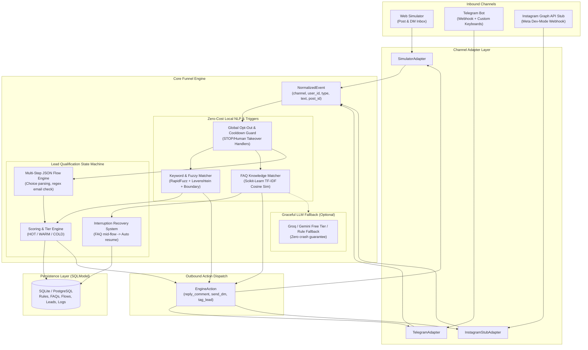

<div align="center">

# ⚡ FunnelBot

### Zero-Budget Comment & DM Lead Qualification Funnel for Creators and Businesses

[](https://github.com/funnelbot/funnelbot/actions/workflows/ci.yml)
[](https://www.python.org/)
[](https://fastapi.tiangolo.com)
[](https://github.com/funnelbot/funnelbot)
[](https://opensource.org/licenses/MIT)
[](https://github.com/funnelbot/funnelbot)

**Automates comment-to-DM lead capture with $0 infrastructure, zero paid API keys, and sub-50MB RAM usage.**

[Live Recruiter Demo](https://funnelbot-demo.onrender.com) • [2-Minute Walkthrough](DEMO.md) • [Architecture](#-architecture) • [Quickstart](#-quickstart-in-60-seconds) • [Deployment](#-free-tier-deployment-guide)

---

</div>

## 📌 Executive Summary

Creators and businesses lose up to 80% of warm social leads because human response times in comments and direct messages average 4 to 12 hours. Existing marketing automation tools (ManyChat, Gorgias) cost $50–$300/month, lock creators into rigid proprietary ecosystems, and rely heavily on costly paid LLM token calls.

**FunnelBot** is an open-source, channel-agnostic automation engine built from scratch under extreme constraints:
- **$0 Total Infrastructure Cost**: Runs smoothly within free-tier container limits (Render, Hugging Face Spaces, Fly.io, or Railway).
- **Sub-50MB RAM Footprint**: High-precision local NLP using `rapidfuzz` and `scikit-learn` TF-IDF vectors instead of memory-heavy transformer models.
- **2-Minute Recruiter Demo**: Includes a dual-screen social simulator (mock Instagram post + live DM chat + real-time Engine Inspector) allowing anyone to experience the full funnel with zero signups or test accounts.
- **Enterprise-Ready Clean Architecture**: Strict Adapter Pattern decoupling channels (Simulator, Telegram, Meta Graph API stub) from core state machine qualification logic.

---

## 🏗️ Architecture

FunnelBot normalizes events from any social channel into a unified event pipeline, processes them through a deterministic multi-stage funnel engine, and dispatches actions back out.



---

## ✨ Key Features

### 1. Comment Keyword Automation & Typo Tolerance
- **Three Matching Modes**: `exact`, `contains` (with word boundaries to avoid false positives like "cat" inside "catalog"), and `fuzzy` (Levenshtein distance via `rapidfuzz`).
- **Typo Tolerance**: Tolerates realistic user misspellings (e.g., commenting `"giude"` or `"guiee"` correctly triggers the `"guide"` funnel).
- **Anti-Spam Public Replies**: Rotates through a randomized list of public replies to keep comment threads looking natural and organic.
- **Smart Cooldown Deduplication**: Per-user, per-rule cooldown windows prevent comment spamming and duplicate DM dispatches.

### 2. High-Precision Local FAQ Answering (TF-IDF)
- **Zero-Dollar Vector Search**: Vectorizes incoming queries using `scikit-learn` `TfidfVectorizer(ngram_range=(1,2))` with stop-word filtering and cosine similarity against indexed questions.
- **Three-Tier Confidence Scoring**:
  - `score >= 0.55` (High): Instant autonomous answer.
  - `0.30 <= score < 0.55` (Medium): Interactive disambiguation: *"Did you mean: [Closest FAQ Question]?"* with quick-action reply options.
  - `score < 0.30` (Low): Polite fallback response with an automatic flag for human team takeover.
- **Mid-Flow Interruption Recovery**: If a lead asks a pricing or security question mid-qualification, the engine answers the FAQ and immediately resumes the state machine with *"Back to where we were..."*.

### 3. Lead Qualification State Machine
- **Configurable Multi-Step Flows**: Define sequential qualification paths with choices, point weights, and validation rules in clean JSON.
- **Regex Validation**: Validates sensitive inputs like email addresses; re-prompts politely on malformed entries.
- **Lead Scoring & Dynamic Tiers**:
  - `HOT` ($\ge 70$ pts): High-intent leads immediately receive a Cal.com booking link.
  - `WARM` (40–69 pts): Moderate-intent leads receive a detailed case study or tailored pitch deck.
  - `COLD` (<40 pts): Low-budget or early-stage leads receive an automated free toolkit or newsletter signup.
- **Resumable 24-Hour Timeout**: Automatically expires abandoned sessions after 24 hours while allowing active prospects to resume seamlessly.
- **Compliance & Safety**: Instant `STOP`/`unsubscribe` opt-out guarantees no further automated messages are dispatched.

### 4. Interactive Recruiter Simulator (Dual-Screen UI)
- **Zero-Signup Instant Demo**: Designed so recruiters, hiring managers, and clients can test the complete funnel in under 2 minutes.
- **Side-by-Side View**: Left pane features an interactive Instagram post card with comment box; right pane features an active direct message inbox.
- **Live Engine Inspector**: An expandable diagnostic drawer exposes real-time engine telemetry:
  - Fired rule ID, keyword match type, and similarity percentage.
  - State machine step transitions and accumulated lead score.
  - TF-IDF confidence scores and generated outbound actions.
- **One-Click Demo Reset**: Clears the test user's conversation state, lead records, and trigger cooldowns instantly.

### 5. Full Admin Dashboard & CRM
- **Real-Time Analytics**: Visualizes total comments triggered, DMs dispatched, overall conversion rates, lead tier breakdowns (Chart.js doughnut chart), and step-by-step funnel drop-off (Chart.js bar chart).
- **Rules Manager**: Full CRUD modal to add, edit, or toggle keyword triggers and response templates.
- **FAQ Knowledge Base**: Manage questions and test queries in real time using the built-in TF-IDF sandbox runner.
- **Lead CRM & One-Click CSV Export**: Filter qualified leads by `HOT`, `WARM`, or `COLD` and export clean CSV datasets for downstream CRM ingest (HubSpot, Salesforce).
- **Conversation Audit Log**: Chronological inspection log capturing raw channel payloads, normalized events, and confidence telemetry.
- **Security**: Protected by single environment variable `ADMIN_PASSWORD` (supports HTTP Basic Auth and session header tokens), with safe read-only demo mode for public deployments.

### 6. Production-Ready Channel Adapters
- **Telegram Bot Adapter**: Real-world channel integration using Telegram Bot API webhooks (`/webhooks/telegram`) with secret-token verification and inline custom reply keyboards.
- **Instagram Graph API Stub**: Dev-mode adapter implementing Meta's `GET /webhooks/instagram` challenge verification handshake (`hub.mode`, `hub.challenge`, `hub.verify_token`) and batched message/comment parser.

---

## ⚡ Quickstart in 60 Seconds

### Prerequisites
- Python 3.11+
- Git

### Native Local Setup

```bash
# 1. Clone the repository
git clone https://github.com/funnelbot/funnelbot.git
cd funnelbot

# 2. Create and activate a virtual environment
python3 -m venv .venv
source .venv/bin/activate  # On Windows: .venv\Scripts\activate

# 3. Install dependencies
pip install -r requirements-dev.txt

# 4. Copy environment defaults
cp .env.example .env

# 5. Launch the application
uvicorn app.main:app --reload --port 8000
```

Open your browser to:
- **Simulator & Live Demo**: [http://localhost:8000](http://localhost:8000)
- **Admin Dashboard**: [http://localhost:8000/#analytics](http://localhost:8000/#analytics)
- **Interactive Swagger API Docs**: [http://localhost:8000/docs](http://localhost:8000/docs)
- **Health Diagnostics**: [http://localhost:8000/health](http://localhost:8000/health)

---

## 🐳 Docker & Docker Compose

Run the entire application in an isolated, lightweight container:

```bash
# Build and run with Docker Compose
docker-compose up --build

# Run in background
docker-compose up -d

# Check container health status
docker ps
curl http://localhost:8000/health
```

---

## 🧪 Test Suite & Quality Assurance

FunnelBot maintains an exhaustive test suite with **90% code coverage** testing every engine component, edge case, and channel adapter:

```bash
# Run all tests with coverage report
pytest

# Run Ruff linter
ruff check app/ tests/ scripts/
```

### Tested Scenarios Include:
- Exact, contains, word-boundary, and typo-tolerant fuzzy keyword matching.
- TF-IDF threshold boundaries (auto-reply, did-you-mean suggestion, and fallback).
- Out-of-vocabulary queries and stop-word filtering.
- State machine branch progression, choice selection, and regex email validation.
- Mid-flow FAQ interruption and automatic context resumption.
- Idempotency key handling on duplicate webhook events.
- Global `STOP` opt-out and manual takeover `human` command flags.
- Cooldown deduplication preventing multiple DMs within the throttle window.
- Telegram webhook signature verification and inline keyboard generation.
- Instagram `hub.challenge` verification and batched payload normalization.

---

## 🚀 Free-Tier Deployment Guide

Deploy FunnelBot for **$0/month** on any free container or web service provider:

### Option A: Render (Recommended)
1. Push your repository to **GitHub**.
2. Sign in to [Render.com](https://render.com) and click **New +** $\rightarrow$ **Web Service**.
3. Connect your repository.
4. Select runtime: **Docker** (Render will detect the `Dockerfile`).
5. Choose instance type: **Free**.
6. In **Environment Variables**, set:
   ```env
   DEMO_MODE=true
   ADMIN_PASSWORD=your_secure_password
   RATE_LIMIT_PER_MINUTE=60
   ```
7. Click **Deploy Web Service**. You will receive an active HTTPS URL: `https://your-funnelbot.onrender.com`.

### Option B: Hugging Face Spaces (Docker)
1. Create a new Space on [Hugging Face](https://huggingface.co/spaces).
2. Select SDK: **Docker** (Blank).
3. Push the repository to the Space remote.
4. Set container port to `8000` in Settings $\rightarrow$ Environment Variables.

### Keep-Awake Ping (Prevent Cold Starts)
Render free instances spin down after 15 minutes of inactivity:
1. Create a free account on [UptimeRobot](https://uptimerobot.com).
2. Add a new **HTTP(s) Monitor**:
   - URL: `https://your-funnelbot.onrender.com/health`
   - Interval: Every 5 or 10 minutes.

---

## 🤖 Connecting a Live Telegram Bot (Free & Instant)

You can connect a real, free Telegram bot to your FunnelBot instance in under 3 minutes:

1. Open Telegram and search for **@BotFather**.
2. Send `/newbot`, choose a name (e.g. `MyGrowthFunnelBot`), and copy the API token.
3. In your `.env` (or Render Environment Variables), set:
   ```env
   TELEGRAM_BOT_TOKEN=123456789:ABCdefGhIJKlmNoPQRsTUVwxyZ
   TELEGRAM_WEBHOOK_SECRET=your_random_secret_string
   ```
4. Register the webhook:
   ```bash
   python scripts/setup_telegram_webhook.py \
     --token 123456789:ABCdefGhIJKlmNoPQRsTUVwxyZ \
     --url https://your-funnelbot.onrender.com/webhooks/telegram \
     --secret your_random_secret_string
   ```
5. Open Telegram and message your bot! Type `/start` to begin the funnel or ask any question.

---

## ⚖️ Architectural Tradeoffs & Design Decisions

| Decision | Chosen Approach | Alternative Considered | Rationale |
|---|---|---|---|
| **FAQ NLP Engine** | Local `scikit-learn` TF-IDF + Cosine Similarity | Hosted LLM embeddings (OpenAI / Cohere) | **$0 Cost & Low Latency**: Runs deterministically in <50MB RAM with sub-millisecond query execution. No billing setup, no rate limits, no third-party downtime. |
| **Fuzzy Matching** | `rapidfuzz` (C++ Levenshtein binding) | Pure regex or LLM classifier | **Speed & Memory**: RapidFuzz provides lightning-fast Levenshtein and token-set ratios without external API costs or model latency. Handles typos like `"giude"` instantly. |
| **Architecture** | Channel Adapter Pattern (`NormalizedEvent`) | Coupled channel route handlers | **Extensibility**: The core funnel engine has zero knowledge of Telegram or Instagram APIs. Adding a new channel (e.g., WhatsApp, Discord) requires only a single adapter class. |
| **Persistence** | `SQLModel` + SQLite | Raw SQLAlchemy / MongoDB / DynamoDB | **Simplicity & Portability**: Combines SQLAlchemy 2.0 with Pydantic v2 validation. Works zero-config with SQLite locally and drops into Neon or Supabase PostgreSQL via a single `DATABASE_URL` switch. |
| **Frontend** | Single-Page Vanilla UI served by FastAPI static mount | Separate Next.js / Vite SPA deployment | **Single-Service Deploy**: Deploys as ONE unified container on free tiers without managing CORS, separate CDN builds, or split hosting accounts. |
| **LLM Strategy** | Pluggable fallback (Default = None, optional Groq/Gemini) | Mandatory LLM-in-the-loop | **Zero Crash Guarantee**: If API keys are absent or free quotas run out, the engine gracefully falls back to deterministic rules without interruption. |

---

## 🔮 What I'd Do Next (Future Roadmap)

- **WhatsApp Cloud API Adapter**: Add official Meta WhatsApp Business Cloud API webhook and message template support.
- **pgvector Semantic Search**: Provide a toggle for PostgreSQL `pgvector` hybrid retrieval (BM25 + dense neural embeddings) when running on scalable infrastructure.
- **Multi-Tenant Workspaces**: Enable agency creators to host multiple brands, separate team permissions, and distinct funnel pipelines on a single instance.
- **Live Webhook Integrations**: Native webhook dispatchers sending qualified `HOT` leads directly to HubSpot, Zapier, Make.com, or Slack channels.
- **A/B Testing Funnel Splitter**: Route traffic across multiple qualification flows to measure conversion rates and question drop-offs.

---

## 📄 License

This project is licensed under the MIT License - see the [LICENSE](LICENSE) file for details.
